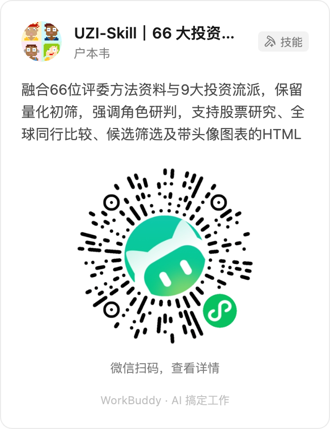

# UZI-Skill

[中文](README.md) | [English](README_EN.md) | **日本語**

中国A株・香港株・米国株を対象とした、エージェント向けの株式リサーチスキルです。公開データを集め、財務・バリュエーション・リスクを検討します。**66人の投資家を参考にした9つの流派、22の分析軸、22の機関投資家向け手法**を備えています。マニフェストのバージョンは **v3.9.4** です。

[インストール](#インストール) · [分析の進め方](#分析の進め方) · [銘柄スクリーニング](#銘柄スクリーニング) · [業種ローテーション](#業種ローテーション) · [変更履歴](#変更履歴) · [サポート](#サポート)

## WorkBuddy

UZI-Skill は WorkBuddy でも利用できます。WeChat で下のミニプログラムコードを読み取ると、スキルの詳細を確認できます。

<p align="center">
  <a href="docs/screenshots/workbuddy-skill-share.png"></a>
</p>

アクティブファンドやファンドマネージャーの調査には、別プロジェクトの [jilao-skills](https://github.com/wbh604/jilao-skills) を参照してください。

## インストール

| 環境 | 手順 |
| --- | --- |
| Claude Code | `/plugin marketplace add wbh604/UZI-Skill`、続いて `/plugin install stock-deep-analyzer@uzi-skill` |
| Codex | [Codex のインストール手順](.codex/INSTALL.md) |
| Cursor | `/add-plugin stock-deep-analyzer` |
| Gemini CLI | `gemini extensions install https://github.com/wbh604/UZI-Skill` |
| OpenCode / Hermes | [OpenCode の手順](.opencode/INSTALL.md) / [Hermes の手順](INSTALL-HERMES.md) |

CLI には Python 3.10 以上が必要です。コマンドはリポジトリのルートで実行します。

```bash
git clone https://github.com/wbh604/UZI-Skill.git
cd UZI-Skill
python3 -m pip install -r requirements.txt
python3 run.py 600519.SH --depth lite --no-browser
```

## 分析の進め方

| 深さ | 用途 | 判断の作り方 |
| --- | --- | --- |
| `lite` | 主要データの確認と初期調査 | ルールによる短い分析 |
| `medium`（既定） | 通常の個別銘柄調査と HTML レポート | CLI で完結できる標準分析 |
| `deep` | DCF、投資委員会メモ、初回カバレッジなど | データ収集後、エージェントが投資家の方法論と根拠を照合し、`agent_analysis.json` を作成・検証してからレポートを生成 |

Claude Code では `/stock-deep-analyzer:quick-scan 600519.SH` や `/stock-deep-analyzer:analyze-stock 00700.HK` と指定できます。米国株には `AAPL` のようなティッカーを使います。深掘りする場合は、エージェントに「deep で分析し、投資家ごとの着眼点と反証を示してください」と伝えてください。CLI の `--depth deep` だけではレビューは完了しません。[詳細手順](skills/deep-analysis/SKILL.md)を参照してください。

- **投資家の視点**：バリュー、グロース、マクロ、テクニカル、中国の長期投資、中国の短期売買、クオンツ、テクノロジー、Serenity の9流派。`--school A` から `--school I` のいずれかで流派を指定できます。
- **比較とモデル**：海外を含む同業他社の業績比較、DCF、決算レビュー、カタリスト、投資委員会メモなど。通貨や決算期がそろわない比較には注意が必要です。
- **HTML レポート**：評価の根拠、反対意見、欠損データ、チャートと投資家プロフィールを表示します。[画面例](docs/screenshots/hero-score.png)は過去のレポートです。
- **判断の制約**：投資家風のコメントは方法論を参考にしたシミュレーションで、本人の発言や保有状況ではありません。根拠が足りない場合は未評価・棄権とし、欠損値を実測のゼロとして扱いません。

データの取得範囲は市場とネットワーク環境によって異なります。東方財富の妙想 API を使う場合は `MX_APIKEY` を設定できます（[環境変数の例](.env.example)）。ブラウザーでデータを補う処理は、利用可能な Chrome / Edge を再利用できます。`UZI_BROWSER_PATH` で実行ファイルを明示することもできます。

## 銘柄スクリーニング

```bash
python3 screen.py --mode noon --markets A,H --top 10 --no-browser
python3 screen.py --mode close --markets A,H --snapshot-only --no-browser
```

中国A株と香港株の候補を、流動性などの条件と短期売買・Serenity のルールから抽出します。条件を満たす銘柄だけを最大10件表示します。ニュース、業種、分足の裏付けが不足していれば観察扱いです。売買の指図や執行は行いません。

## 業種ローテーション

```bash
python3 rotate.py --input-csv /path/to/local-input.csv --as-of YYYY-MM-DD
```

利用権限のあるローカル CSV から、業種順位、週次のモデル目標、HTML・JSON・CSV を生成します。任意の申万業種の代理観測は、中信業種の正式計算に混ぜません。入力データのダウンロードや自動売買は行いません。[データ契約と制約](docs/industry-rotation.md)を参照してください。

実データ、順位、モデル保有銘柄、レポート、スクリーンショット、それらを含むアーカイブはローカルに保管し、GitHub や配布用のスキルパッケージにはアップロードしないでください。

## 変更履歴

| 区分 | 日付 | 内容 |
| --- | --- | --- |
| main の保守更新 | 2026-11-18 | 日本語 README を追加。東方財富の主力資金データがない場合は、新浪の大口取引の集計を参考情報として別表示。採点・投票・東方財富の時系列には混ぜません。[検証記録](docs/capital-flow-sources.md) |
| main の保守更新 | 2026-11-18 | 旧収集処理のタイムアウト、競争分析の欠損値、システムブラウザー再利用を修正。[詳細](docs/maintenance-2026-11-18.md) |
| main の保守更新 | 2026-11-05 | ローカル CSV で業種資金フローを調べる `rotate.py` を追加。[詳細](docs/industry-rotation.md) |

これらは新しいバージョンタグではありません。過去の変更は[英語版の履歴](README_EN.md#changelog)と[リリースノート](RELEASE-NOTES.md)を参照してください。

## サポート

- 不具合・改善提案：[GitHub Issues](https://github.com/wbh604/UZI-Skill/issues)
- 中国語コミュニティ：QQ グループ **1126403930**（[参加用 QR コード](docs/screenshots/qq-group-1126403930.png)）
- ライセンス：[MIT](LICENSE)

このスキルはリサーチ補助用です。データの完全性、配信状況、将来の投資結果を保証せず、投資助言ではありません。
