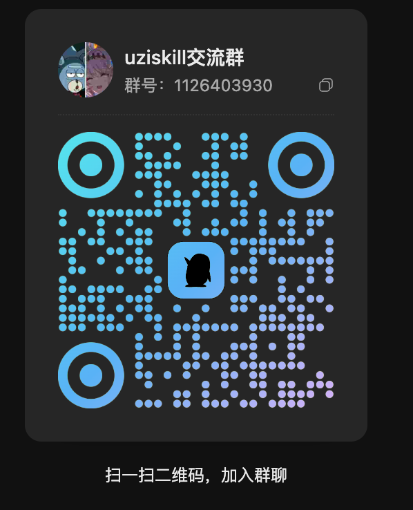

<div align="center">

# 游资 (UZI) Skills

*「66 人の伝説的な投資家があなたの銘柄選びを審査します。バフェットと中国の個人デイトレーダーが、ついに同じテーブルにつきました。」*

[](LICENSE)
[](https://python.org)
[](https://claude.com/product/claude-code)
[]()
[]()
[]()
[](skills/deep-analysis/scripts/tests)

**A 株／香港株／米国株のディープ分析エンジンです。西洋の金融端末が扱わない中国市場を一級品としてカバーします。66 人の投資家 × 9 の学派 × 22 の分析軸 × 22 の機関投資家向け手法。main は 2026-11-05 に更新：業種別資金フローのローテーション研究を追加しました。コア分析は公開データを使います。オプションのローテーションツールには、ユーザーが用意したローカル CSV が必要です。マニフェストのバージョン：v3.9.4。**

[インストール](#インストール) · [使い方](#使い方) · [西洋の投資家が注目すべき理由](#-西洋の投資家が注目すべき理由) · [審査団](#-66-人の投資家審査団) · [手法](#-22-種類の機関投資家向け手法) · [スクリーンショット](#-レポートの見た目) · [FAQ](#-faq) · [QQ グループ](#qq-group)

[English](README_EN.md) | [中文](README.md) | **日本語**

</div>

---

## 変更履歴

以下のメンテナンス更新は `main` に入っています。新しいバージョンタグではありません。マニフェストは `v3.9.4` のままです。

| バージョン／トラック | 日付 | 変更内容 |
| --- | --- | --- |
| **main メンテナンス** | **2026-11-05** | 独立した `rotate.py` を追加：CITIC 40 業種のアクティブ資金フロー因子、W20–24 ランキング、週次のモデル目標、JSON/CSV/HTML 出力、別途インポートする申万の代理観測値。許諾が必要な入力データは同梱していません。自動売買や運用成績の主張はありません。[手法とデータ契約](docs/industry-rotation.md)。 |
| **main メンテナンス** | **2026-10-18** | 実際のゼロ値・損失値を保持し、不明な根拠やプレースホルダーのルールは棄権するようにしました。実際に返された保有四半期を使い、ファンドの識別子と比率の重みを正規化し、古い／無効なサンプルを除外し、報告期間のカバレッジを表示します。回帰テストを 56 件追加しました。**948 passed, 1 skipped**。[Commit b49bccd](https://github.com/wbh604/UZI-Skill/commit/b49bccdd84c385a491a2001d2297ad256b10b0d7)、[詳細](docs/maintenance-2026-10-17.md)。 |
| **main メンテナンス** | **2026-10-16** | PR #114–#117 と #119–#122 を統合：スキャン予算、プロファイル対応キャッシュ、発行体チェック、LHB の根拠、モデルゲート、棄権とコンセンサスの再計算。バリュエーションのパーセンタイルと macOS フックを修正しました。**892 passed, 1 skipped**。[Commit 2c5505d](https://github.com/wbh604/UZI-Skill/commit/2c5505d9d30363379ce708f85cac93f86b2788cf)、[詳細](docs/maintenance-2026-10-16.md)。 |

オフラインの回帰テスト結果は、ライブデータの可用性や投資成績を保証するものではありません。それ以前のバージョンについては[リリースノート全文](RELEASE-NOTES.md)を参照してください。

### 業種別資金フローのローテーション

```bash
python3 rotate.py --input-csv /path/to/citic_industry_fund_flow.csv --as-of 2026-11-04
```

Python の標準ライブラリを使います。日付入りの HTML・JSON・CSV を出力し、基本ランキングと近似 5 因子ランキング、W20–24 の共通選定、直近で確定した週次のモデル目標を含みます。オプションの `--proxy-json` は、元の研究ツールから日付入りの申万30 観測値をインポートします。これは正式な CITIC40 の計算には入りません。ライブデータのダウンロード、バックテストのリターンの主張、ETF への対応付け、注文執行は行いません。既存の個別株分析とスクリーニングのゲートは変わっていません。[データ契約と制限事項](docs/industry-rotation.md)を参照してください。

このツールはデータ提供元に依存せず、ローカル専用です。実際のローテーション入力、ランキング、モデルの保有銘柄、レポート、スクリーンショット、アーカイブを GitHub、リリース、ホスティングされたページ、配布するスキルパッケージにアップロードしてはいけません。リポジトリにはコードと合成テストだけが含まれます。公開前に `python3 skills/deep-analysis/scripts/lib/industry_rotation/privacy.py` を実行してください。CI でもこのチェックを繰り返しますが、すでに行われたアップロードは防げません。

## 🌏 西洋の投資家が注目すべき理由

中国国外から中国の A 株を調べようとしたことがあるなら、その苦労をご存じでしょう。
- Bloomberg は香港株と ADR をカバーしていますが、A 株のデータは薄く、背景情報が欠けています。
- Reuters / FT が伝えるのはマクロのヘッドラインで、企業ごとのファンダメンタルズではありません。
- Anthropic の [financial-services-plugins](https://github.com/anthropics/financial-services-plugins) は優れた機関投資家向けモデル（DCF / LBO / Comps）を提供していますが、**米国株のみ**で、有料の FactSet / S&P のフィードが必要です。
- 結局 Eastmoney から Google 翻訳経由でコピペすることになり、Excel で DCF を組み終えるころには、銘柄はもう 8% 動いています。

**このプラグインは、その問題の中国側の半分を解決します。** A 株／H 株／米国株を同じインターフェースで読み込み、20 以上の無料の中国データソース（akshare / Eastmoney / XueQiu / CNInfo / HKEXNews / mx妙想 API）とやり取りし、Claude が中国企業について、ティッカーを訳すだけでなく実際に推論できるだけの文脈を渡します。

これが存在する理由でもあります。**伝説的な投資家でさえ中国株を見誤るのなら、普通の投資家はあらゆる分析上の優位性を必要とします。** チャーリー・マンガーは 2021 年に Daily Journal Corp を通じてアリババ（BABA）を大量に買い込みましたが、約 70% の下落を受けて 2022 年にはポジションを半分に減らさざるを得ませんでした。2022 年の DJCO 年次総会で、[マンガーはこれを「私が犯した最悪の過ちの一つ」と呼びました](https://www.cnbc.com/2023/02/15/charlie-munger-says-he-regrets-alibaba-investment-one-of-the-worst-mistakes.html)。損失は 9 桁ドル規模と推定されています。史上最高の投資家の一人でさえ、中国の規制や競争環境がどれほど違う動きをするかを過小評価していたのです。

というわけで、このプラグインは **Alibaba**（`BABA` / `09988.HK`）、**Tencent**（`00700.HK`）、**Kweichow Moutai**（`600519.SH`）、**CATL**（`300750.SZ`）、**BYD**（`002594.SZ`）、**Pop Mart**（`09992.HK`）、**Pinduoduo**（`PDD`）といった中国銘柄の理解を助けます。西洋のポートフォリオに何度も登場し、持ち主を驚かせ続けている銘柄です 😉

---

## 何ができるか

ひとことで言えば、ティッカーを渡すと Claude があなたのアナリストになります。**22 の分析軸のデータ**を集め、**22 のウォール街の分析モデル**を実行し、**それぞれ異なる手法を持つ 66 人の投資家**が銘柄を採点し、600 KB の Bloomberg 風 HTML レポートを作成します。

```
/stock-deep-analyzer:analyze-stock 600519         # Kweichow Moutai (A-share)
/stock-deep-analyzer:analyze-stock 00700.HK       # Tencent (HK)
/stock-deep-analyzer:analyze-stock BABA           # Alibaba ADR
/stock-deep-analyzer:analyze-stock AAPL           # Apple
```

5〜8 分後に、次のものが手に入ります。
- **自己完結型の HTML レポート**：どのブラウザーでも開け、オフラインでも動きます
- SNS 向けの**縦長シェアカード**（1080×1920）
- **横長の戦況レポートカード**（1920×1080）
- チャット／Slack／Telegram 向けの**1 行サマリー**

---

<a id="qq-group"></a>

## QQ グループとフィードバック

**uziskill コミュニティ · QQ グループ：1126403930**

QQ でグループ **1126403930** を検索するか、下の QR コードを読み取ってください。グループは主に中国語で運営されています。英語でのフィードバックは GitHub で issue を作成してください。

<p align="center">
  
</p>

> プラグインのサポート、バグ報告、クオンツ研究などの面白いプロジェクトのためのグループです。個別銘柄の議論の場ではありません。

---

## インストール

どのエージェントを使っていても、**1 行で完了します**。

### Claude Code

```
/plugin marketplace add wbh604/UZI-Skill
/plugin install stock-deep-analyzer@uzi-skill
```

そのあと `/stock-deep-analyzer:analyze-stock Tencent` または `/stock-deep-analyzer:analyze-stock 00700.HK` と入力してください。

> ⚠️ **必ず `stock-deep-analyzer:` という名前空間プレフィックスを付けてください**
>
> インストール後、すべてのスキル／コマンドは `stock-deep-analyzer:<name>` の下に置かれます。短い名前（`/analyze-stock`）はどの環境でも解決されるとは限りません。安全のため、常にフルネームを使ってください。
> - `/stock-deep-analyzer:analyze-stock <ticker>`
> - `/stock-deep-analyzer:quick-scan <ticker>`
> - `/stock-deep-analyzer:scan-trap <ticker>`
> - `/stock-deep-analyzer:dcf <ticker>` / `:ic-memo` / `:investor-panel` / `:trap-detector` / ...
>
> Cursor / Gemini CLI / Codex でも同じです。プレフィックス付きのフルネームを使ってください。

### Codex

Codex にこう伝えるだけです。

> https://raw.githubusercontent.com/wbh604/UZI-Skill/main/.codex/INSTALL.md に従って UZI-Skill をインストールし、そのあとアリババ（BABA）をディープ分析してください。

### OpenClaw / 龙虾

> https://github.com/wbh604/UZI-Skill をインストールして、Tencent（00700.HK）を分析してください。

### Cursor

```
/add-plugin stock-deep-analyzer
```

そのあと「analyze BABA」と入力してください。

### Gemini CLI

```bash
gemini extensions install https://github.com/wbh604/UZI-Skill
```

### OpenCode

> https://raw.githubusercontent.com/wbh604/UZI-Skill/main/.opencode/INSTALL.md に従って、Pop Mart（09992.HK）を分析してください。

### Windsurf / Devin / その他のエージェント

これを貼り付けてください。

> https://github.com/wbh604/UZI-Skill をクローンし、`AGENTS.md` を読んでから、アリババ（09988.HK）をディープ分析してください。

### CLI のみ

```bash
git clone https://github.com/wbh604/UZI-Skill.git
cd UZI-Skill && pip install -r requirements.txt
python skills/deep-analysis/scripts/run_real_test.py BABA
```

### 📱 デスクにいないときは？

任意のエージェントにこう伝えてください。

> 00700.HK をリモートモードで分析して、スマートフォンで見られるように公開リンクを生成してください。

エージェントが Cloudflare Tunnel を立ち上げ、`https://xxx.trycloudflare.com` の URL を返します。

---

## 使い方

### フルのディープ分析（5〜8 分）

```
/stock-deep-analyzer:analyze-stock 600519          # A-share by ticker
/stock-deep-analyzer:analyze-stock 00700.HK        # HK
/stock-deep-analyzer:analyze-stock BABA            # US ADR
/stock-deep-analyzer:analyze-stock AAPL            # US
```

> **英語ユーザー向けのティッカー形式のヒント：**
> - A 株：6 桁 + `.SH`（上海）または `.SZ`（深圳）。例：`600519.SH`、`002594.SZ`。`600519` のような 6 桁だけでも使えます。
> - 香港株：5 桁 + `.HK`。例：`00700.HK`、`09988.HK`。
> - 米国株：シンボルそのまま。`AAPL`、`BABA`、`PDD`、`NVDA`。
> - 中国語の社名も解決できます：`贵州茅台`、`腾讯控股`。英語で入力する場合は、社名よりティッカーコードを使ってください（社名の解決は中国語向けに調整されています）。

### 単機能コマンド

> どの環境でも確実に呼び出せるよう、すべてのコマンドに `/stock-deep-analyzer:` プレフィックスが必要です。

| コマンド | 内容 |
|---|---|
| `/stock-deep-analyzer:dcf 600519` | DCF バリュエーション · WACC + 5×5 の感応度表 |
| `/stock-deep-analyzer:comps 002273` | 同業他社比較 · PE / PB のパーセンタイル順位 |
| `/stock-deep-analyzer:lbo 600519` | LBO ストレステスト · PE ファンド買い手の IRR の視点 |
| `/stock-deep-analyzer:initiate BABA` | カバレッジ開始レポート · JPM / GS 形式 |
| `/stock-deep-analyzer:ic-memo BABA` | 投資委員会メモ · 3 シナリオのリターン |
| `/stock-deep-analyzer:earnings AAPL` | 決算のビート／ミス分析 |
| `/stock-deep-analyzer:catalysts 300750` | カタリストカレンダー · 今後 60 日 |
| `/stock-deep-analyzer:thesis 600519` | 投資テーゼの追跡 · 5 本の柱 |
| `/stock-deep-analyzer:screen AAPL` | 5 種類のクオンツスクリーン · バリュー／グロース／クオリティ／GARP／ショート |
| `/stock-deep-analyzer:dd BABA` | デューデリジェンスのチェックリスト · 5 つのワークストリームにまたがる 21 項目 |
| `/stock-deep-analyzer:quick-scan 00700.HK` | 30 秒の健全性チェック |
| `/stock-deep-analyzer:panel-only 600519` | 66 人の投資家審査団だけを実行 · HTML レポートなし |
| `/stock-deep-analyzer:scan-trap 600519` | 仕手株／罠の検出（8 つのシグナル） |
| `/stock-deep-analyzer:segmental-model 300308` | 🆕 ボトムアップのセグメント別売上モデル · 3 シナリオ × 3 年の予測 · トップダウンの DCF とクロスチェック |

---

## 🎚️ 3 段階の分析の深さ（v2.10.3 で追加）

どれだけ考えさせるかをユーザーが選べます。クイック／標準／ディープ：

```bash
python run.py 600519 --depth lite     # ⚡ Quick read (1-2 min)
python run.py 600519                    # 📊 Standard (5-8 min) · default
python run.py 600519 --depth deep       # 🔬 Institutional (15-20 min)
```

環境変数でも指定できます。

```bash
export UZI_DEPTH=lite       # or medium / deep
python run.py 600519
```

### 違い

| 項目 | ⚡ **lite** | 📊 **medium** | 🔬 **deep** |
|---|---|---|---|
| **実行時間** | 1〜2 分 | 5〜8 分 | 15〜20 分 |
| **フェッチャー** | コアの 7 軸 | 全 22 軸 | 全 22 軸 + 強化されたフォールバック |
| **投資家** | 代表 10 人 | 51 人のフルパネル | 51 人 + **強気・弱気の構造化ディベート** |
| **機関投資家向け手法** | DCF のみ | 全 17 種 | 全 17 種 + **セグメント別積み上げ** |
| **ddgs の定性クエリ** | **すべてスキップ**（トークン節約） | 必要に応じて · 予算 30 | フル稼働 · 予算 60 |
| **fund_holders** | 上位 5 件を 5 年分の統計付きで | 上位 20 件はフル + 残りは一覧 | 上位 100 件をフル |
| **自己レビューゲート** | critical でブロック | critical でブロック · warning は確認で通過可 | 両方でブロック |
| **トークンコスト（Codex）** | 最小 | 中程度 | 最大 |
| **用途** | ざっと確認 · 上司に急に聞かれた · ETF の構成銘柄のプレビュー | 日々のディープ分析 · リサーチ執筆 | 投資委員会メモ · ポジションを取る前の徹底調査 |

### 自動ダウングレード

- **初回インストール**／`.cache/_global` が空 → 自動で lite に切り替え（コールドスタートの時間を節約）
- **ネットワークの事前チェックで 3 つ以上のドメインに到達できない** → 自動で lite（ハングを防止）
- 手動の `--depth` は常に自動判定より優先されます

### 適切な深さの選び方

| 質問 | おすすめ |
|---|---|
| 「この株、買っていい？」 | `medium`（デフォルト） |
| 「15 分で結論をちょうだい」 | `lite` |
| 「明日の投資委員会の準備をしている」 | `deep`（強気・弱気のディベート + ボトムアップのセグメント分析を含む） |
| 「ETF のコードを入力したら、構成銘柄を選ぶように言われた」 | `lite`（構成銘柄についての素早い判定） |
| 「Codex 環境／初回インストール」 | 心配いりません。自動で lite になります |

### コマンドごとの暗黙の深さ

| コマンド | 暗黙の深さ |
|---|---|
| `/stock-deep-analyzer:quick-scan 600519` | lite |
| `/stock-deep-analyzer:panel-only 600519` | lite |
| `/stock-deep-analyzer:analyze-stock 600519` | medium（デフォルト） |
| `/stock-deep-analyzer:ic-memo 600519` | deep |
| `/stock-deep-analyzer:initiate 600519` | deep |

---

## 🎭 66 人の投資家審査団

決まり文句ではありません。投資家ごとに独自の**定量化されたルールセット**（合計 242 ルール）、独自の**実際の発言に基づく語り口**、独自の**本物の意思決定プロファイル**（投資期間／ポジションサイズ／考えを変える条件）があります。

| グループ | スタイル | 代表的な投資家 |
|---|---|---|
| A | クラシックなバリュー | Buffett · Graham · Munger · Fisher · Templeton · Klarman |
| B | グロース | Lynch · O'Neil · Thiel · Cathie Wood · Andreessen · Gurley · Naval · Gerstner · Chamath |
| C | マクロ／ヘッジ | Soros · Dalio · Howard Marks · Druckenmiller · Julian Robertson · Burry · Chanos |
| D | テクニカル | Livermore · Minervini · Darvas · Gann |
| E | 中国のバリュー | Duan Yongping (段永平) · Zhang Kun · Zhu Shaoxing · Xie Zhiyu · Feng Liu · Deng Xiaofeng · Zhang Lei (高瓴) |
| F | A 株のデイトレーダー（游资） | Zhao Laoge · Zhang Mengzhu · Foshan Shadowless Kick · 股海贼王（実際の売買記録から抽出） |
| G | クオンツ | Simons · Thorp · David Shaw · Cliff Asness |
| H | AI のボトルネックハンター | Jensen Huang · Musk · Sam Altman · Saylor |
| I | Serenity | AI サプライチェーンのチョークポイント／ボトルネックハンター |

**どの判定も、該当した具体的なルールを引用します。** さらに、各投資家は 3 つの質問に自分の語り口で答えます。

| 投資家 | 投資期間 | 考えを変える条件 |
|---|---|---|
| Buffett | 10 年以上／永遠 | ROE が 2 年連続で 12% を下回る · CEO の交代と戦略転換 |
| Zhao Laoge (赵老哥) | T+2〜T+5 | 主導株がストップ高を割り込む · 出来高が裏付けない |
| Simons | 平均保有 2 日未満 | シグナルのシャープレシオが 0.5 を下回る · ファクターの減衰 |
| Lynch | ストーリーが実現するまで、通常 3〜5 年 | PEG > 2 · 在庫の伸びが売上の伸びを上回る |
| Soros | 再帰性のサイクル 1 回分、数週間〜数か月、いつでも反転 | 市場が自分のナラティブを裏付けなくなる |

発言は**実際の公開資料**から引用しています。Berkshire の株主への手紙、Oaktree のメモ、『Principles』、『Margin of Safety』、Lost Tree Club でのスピーチ、XueQiu／Zhihu のコラムなどで、どの引用も元の出典にリンクしています。

---

## 📐 22 種類の機関投資家向け手法

[anthropics/financial-services-plugins](https://github.com/anthropics/financial-services-plugins) から移植し、A 株／H 株向けのパラメーターに合わせています。

**バリュエーション（6）**：DCF · Comps · 3-Statement · LBO · Merger Model · Unit Economics

**リサーチ（7）**：Initiating Coverage · Earnings Analysis · Catalyst Calendar · Thesis Tracker · Morning Note · Quant Screen · Sector Overview

**意思決定（6）**：IC Memo · Porter 5 Forces + BCG · DD Checklist · Value Creation Plan · Portfolio Rebalance · Trap Detection（このプラグイン独自）

**Tier-1（5）**：AI Readiness · Earnings Preview · Model Update · Returns Attribution · Rebalance

---

## 📸 レポートの見た目

> スクリーンショットはすべて、水晶光電（002273.SZ）の実際の分析から取ったものです。

### スコアダッシュボード


### 大分岐：強気 vs 弱気


### 51 の審査員席


### チャットルームモード


### DCF 感応度ヒートマップ


### 投資委員会メモ：3 つのシナリオ


### 22 軸のディープカード


### SNS シェアカード


---

## 🔓 ログインが必要なデータソース（オプション）

一部のソースは、サンプリングで除外されないようにログインが必要です。**すべてオプトイン**で、デフォルトではログインなしで動きます。その場合はデータが限られます。

| ソース | 利用できるようになるもの | 有効にする方法 |
|---|---|---|
| **XueQiu**（`cubes_search`） | 軸 19 · この銘柄を保有する実際の資金のポートフォリオとそのリターン | `export UZI_XQ_LOGIN=1 && python -m lib.xueqiu_browser login`（初回だけブラウザーでログインを求められます。Cookie は `~/.uzi-skill/playwright-xueqiu/` に保存されます）。またはフラグを使います：`python run.py BABA --enable-xueqiu-login`。 |

有効にしない場合、その軸は `"⚠️ XueQiu login required, 0 cubes shown"` と明示的に報告します。データの欠落が黙って起きることはありません。

---

## ❓ FAQ

**Q：どれくらい時間がかかりますか？**
A：1 銘柄あたり 5〜8 分です。ほとんどはデータ取得の時間で、モデリング自体は 1 秒未満です。

**Q：有料のデータソースは必要ですか？**
A：いいえ。すべて無料です（akshare / yfinance / DuckDuckGo / CNInfo / HKEXNews / Eastmoney / XueQiu のバックエンド）。API キーは一切不要です。A 株の指標を強化したい場合はオプションで `MX_APIKEY`（mx妙想 API）を使えますが、これも無料です。

**Q：米国株や香港株にも使えますか？**
A：はい。`/stock-deep-analyzer:analyze-stock AAPL`、`/stock-deep-analyzer:analyze-stock BABA`、`/stock-deep-analyzer:analyze-stock 00700.HK`。香港株は v2.13.7 から、ローソク足データに 4 段階のフォールバック（Eastmoney → Sina → yfinance → Yahoo Chart v8）があります。

**Q：英語の社名を使えますか？**
A：ティッカーコード（`BABA` / `00700.HK` / `600519.SH`）を使うのが一番です。社名の解決は中国語の社名に対応しています（`贵州茅台` → `600519.SH`）。英語の社名ならティッカーを使ってください。

**Q：66 人の投資家パネルは実在の投資家の発言を引用していますか？**
A：はい。`quotes-knowledge-base.md` には、45 人以上の投資家（西洋 22 人、中国 23 人）の実際に公表された発言が、出典 URL（Berkshire の手紙、Oaktree のメモ、書籍、インタビュー）付きで収められています。エージェントは「バフェット風」のセリフを作り上げるのではなく、**これらの実際の発言を使って**各投資家の語り口をまねるよう指示されています。

**Q：これは投資助言ですか？**
A：**いいえ。** これはリサーチツールであって、占い師ではありません。52 人の投資家の意見はルールエンジンによるシミュレーションで、本人の見解ではありません。Claude のバフェットのものまねに全財産を賭けないでください。

**Q：グレート・ファイアウォールの内側にいますが、データソースは使えますか？**
A：ほとんどは使えます。`akshare` / `yfinance` / Eastmoney / XueQiu はすべて中国本土から使えます。一部の西洋のソース（Bloomberg / Reuters）は使っていません。DuckDuckGo の Web 検索はときどきレート制限がかかります。`3_macro` / `13_policy` / `15_events` の軸が空になる場合は `docs/NETWORK-TROUBLESHOOTING.md` を参照してください。

**Q：中国国外にいますが、中国のデータソースは使えますか？**
A：はい。akshare / Eastmoney / XueQiu / CNInfo / HKEXNews はすべて海外の IP からも利用できます。VPN は不要です。mx妙想 API（A 株の指標）には、無料の `MX_APIKEY` 環境変数が必要です。

**Q：これから読むレポートが信頼できるかどうか、どうすればわかりますか？**
A：v2.9 から、自己レビューは**機械的に強制**されています。HTML の生成前に 13 の自動チェックが走り、critical のチェックが 1 つでも失敗すると、レポートは*物理的に出力できません*。警告は `.cache/<ticker>/_review_issues.json` で確認でき、それぞれに `suggested_fix` が付いています。新しい BUG を修正するたびに対応するチェックが追加されるため、同じ種類のバグは**次の実行で自動的に検出され、ユーザーからのフィードバックは不要です**。

**Q：新しいバージョンは自動で通知されますか？**
A：はい、v2.14.0 からです。CLI の実行やエージェントのセッションのたびに `api.github.com/.../releases/latest` を静かに確認し、新しいタグが出ていれば、リリースノートの要約付きで 3 択のプロンプト（yes / skip-this-version / no）が表示されます。「Skip」はその特定のタグのプロンプトだけを抑止し、さらに新しいバージョンが出ればまた尋ねられます。`export UZI_NO_UPDATE_CHECK=1` で無効にできます（CI / Codex では推奨）。GitHub の未認証時の上限 60 リクエスト／時を超えないよう、結果は 6 時間キャッシュされます。

**Q：以前のバージョンで分析しましたが、そのレポートは正しかったのでしょうか？**
A：2026-04-17 より前に「工業用金属／工作機械／産業機械」の銘柄（雲南アルミ／云铝股份 `000807.SZ` など）を分析した場合、`7_industry` 軸が「農産物・食品加工」に誤分類されていました（BUG#R10）。キャッシュを消して再実行してください。
```bash
rm -rf skills/deep-analysis/scripts/.cache/<ticker>/raw_data.json
python run.py <ticker> --no-resume
```

---

## 🛠 1 枚の図で見るアーキテクチャ

> **v3.0–v3.2 のパイプラインリファクタリング**（2026-04-23）· 2 ファイルからなる旧来のモノリスを、パイプラインのアーキテクチャに分割しました。
> - `run_real_test.py`：2105 → 735 行（-65%）· 純粋関数は `lib/pipeline/score_fns.py` に移動
> - `assemble_report.py`：2964 → 587 行（-80%）· 5 つの `lib/report/*` サブモジュールに分割
> - `python run.py <ticker>` はデフォルトで `pipeline.run_pipeline` を使うようになりました · `UZI_LEGACY=1` で旧方式に戻せます
> - v2.x の公開 API は `re-export` によってすべて維持 · 332 件の pytest がパス · 挙動の差分はゼロ
> v3.2 のリポジトリ構成の詳細は [CODEX.md](CODEX.md) / [AGENTS.md](AGENTS.md) を参照してください。

```
          user says "/analyze-stock BABA"
                       ↓
   ┌──────────────────────────────────────────────┐
   │   Task 1 · Stage1 — parallel data fetch      │
   │   22 fetchers × 20+ sources                  │
   │   (akshare / yfinance / DDG / mx / cninfo …) │
   └──────────────────────────────────────────────┘
                       ↓ raw_data.json
   ┌──────────────────────────────────────────────┐
   │   Task 2 · Rule engine scoring               │
   │   22 dims → dimensions.json                  │
   │   52 investors × 180 rules → panel.json      │
   └──────────────────────────────────────────────┘
                       ↓ HARD-GATE (agent takes over)
   ┌──────────────────────────────────────────────┐
   │   Task 3 · Agent analysis                    │
   │   reads quotes-knowledge-base.md             │
   │   writes agent_analysis.json                 │
   │     (dim_commentary · panel_insights ·       │
   │      great_divide · narrative_override …)    │
   └──────────────────────────────────────────────┘
                       ↓ stage2 merge
   ┌──────────────────────────────────────────────┐
   │   Task 4 · Synthesis · style weighting       │
   │   7+1 stock style × 7 investor-school matrix │
   │   → synthesis.json                           │
   └──────────────────────────────────────────────┘
                       ↓
   ┌──────────────────────────────────────────────┐
   │   🛡 v2.9 · Mechanical self-review gate       │
   │   lib/self_review.py — 13 auto checks         │
   │   critical > 0 → RuntimeError (BLOCK HTML)    │
   │   agent must fix issues → re-review → pass    │
   └──────────────────────────────────────────────┘
                       ↓ only when passed
   ┌──────────────────────────────────────────────┐
   │   Task 5 · Report assembly                   │
   │   → full-report.html (single file, offline)  │
   │   → share-card.png · war-report.png          │
   └──────────────────────────────────────────────┘
```

### 🛡 機械的な自己レビューゲート（v2.9 で追加）

以前のバージョンには、ソフトな「HARD-GATE-FINAL-CHECK」しかありませんでした。エージェントは飛ばしたり、忘れたり、半分だけやったりできました。BUG#R10（中国のアルミ生産会社が「農産物・食品加工」に分類された）は、レポートがすでにユーザーに送られたあとで見つかりました。**ソフトなゲートでは不十分です。v2.9 では機械的に強制します。**

`lib/self_review.py` は、HTML を生成する前に **13 の自動チェック**を実行します。各チェックは過去の BUG に対応しています。

| 重大度 | チェック | 検出するもの |
|---|---|---|
| 🔴 critical | 業種マッピングの妥当性 | BUG#R10 の衝突（工业金属 → 农副食品加工） |
| 🔴 critical | 全軸がそろっている | wave2 のタイムアウトで `12_capital_flow` が欠落 |
| 🔴 critical | 香港株のローソク足データがある | BUG#R8 香港株のローソク足にフォールバックがない |
| 🔴 critical | 香港株の財務データが埋まっている | BUG#R7 空のスタブ |
| 🔴 critical | パネルが空でなく、スコアが妥当 | パネルエンジンの不具合 |
| 🔴 critical | coverage_pct ≥ 60% | データの完全性の下限 |
| 🔴 critical | 「[PLACEHOLDER]」の文字列がない | テンプレートの漏れ |
| 🔴 critical | agent_analysis.json が存在し、レビュー済み | エージェントの処理飛ばし |
| 🟡 warning | DCF / Comps がすべてゼロではない | バリュエーションのパイプラインのチェック |
| 🟡 warning | 金属株に素材のデータがある | v2.8.x のカバレッジの穴 |
| 🟡 warning | 作り話のナラティブがない（例：根拠なしの「Apple のサプライチェーン」） | ハルシネーション対策 |

`assemble_report::assemble()` は `review_all(ticker)` を自動で実行します。`critical_count > 0` なら `RuntimeError` を送出するため、**問題のあるレポートを出力することは物理的に不可能です**。エージェントは次のことを行う必要があります。

```
loop:
  1. python review_stage_output.py <ticker>
  2. read .cache/<ticker>/_review_issues.json
  3. for each critical: execute suggested_fix (backfill, refetch, override)
  4. re-run review
  5. only when critical_count == 0 → HTML generation proceeds
```

新しい BUG を修正するたびに、対応する `check_*` ルールが self_review に追加されます。同じ種類のバグは、**ユーザーからのフィードバックを必要とせず、次の実行で自動的に検出されます。**

---

## ⭐ Star History

現在のスター数：

<a href="https://star-history.dera.page/#wbh604/uzi-skill&Date">
 <picture>
   <source media="(prefers-color-scheme: dark)" srcset="https://star-history.dera.page/svg?repos=wbh604/uzi-skill&type=Date&theme=dark" />
   <source media="(prefers-color-scheme: light)" srcset="https://star-history.dera.page/svg?repos=wbh604/uzi-skill&type=Date" />
   
 </picture>
</a>

> 注：star-history.dera.page はサーバー側で 24 時間キャッシュするため、急成長している日はグラフが遅れることがあります。実際の現在の数は上の shields.io のバッジを見るか、グラフをクリックしてライブの star-history.dera.page のページを開いてください（それによってバックエンドの更新が走ります）。

---

## ⚠️ 免責事項

このツールは、公開データに対して AI モデルを使い、分析レポートを生成します。スコア、推奨、シミュレーションによるコメントはすべてアルゴリズムの出力であり、実在の投資家の実際の見解を表すものでは**ありません**（引用が本物であっても、それを取り巻く採点はシミュレーションです）。**投資助言ではありません。** 過去の実績は将来の結果を示すものではありません。チャーリー・マンガーは 10-Q を実際に読んでいたのに、アリババで損をしました。投資は自己責任で行ってください。

---

## 謝辞

[Linux.do](https://linux.do/) —「Linux.do is all you need to learn AI.」テストコミュニティに感謝します。

---

<div align="center">

MIT License · Made by FloatFu-true · O.o

</div>
